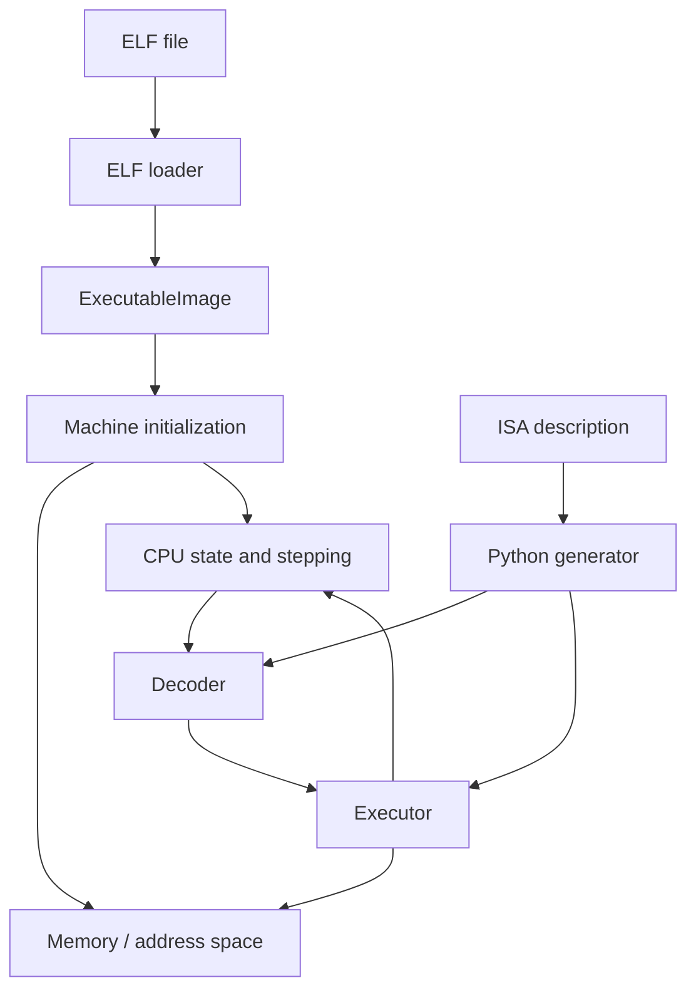
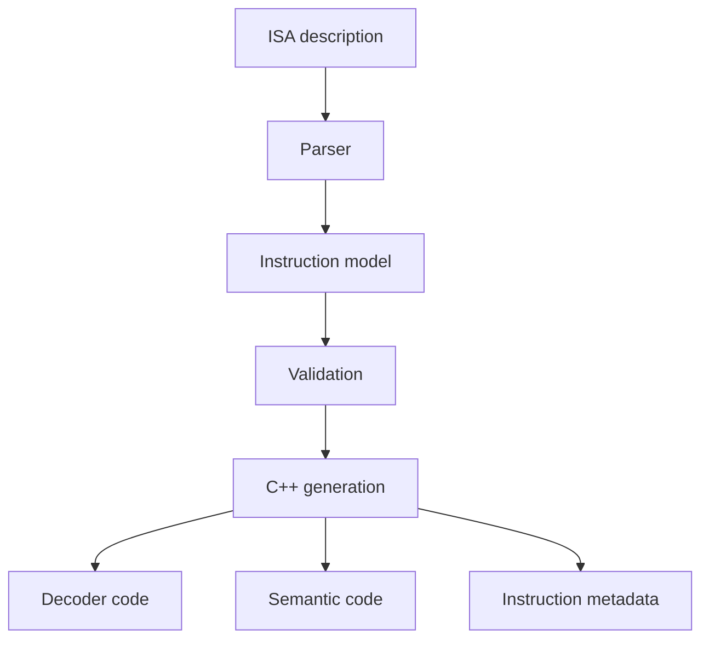

# RISC-V interpreter: architecture notes

Status: long-term design proposal. The implemented decoding milestone uses the generated descriptor
table under `src/decoder/` and the project-owned recipes under `tools/decode_table/`. Sections that
describe generated execution semantics or opcode-indexed dispatch tables are future design material,
not a description of the current implementation.

Project: [riscv-interpreter-task](https://gitlab.com/iDang3r/riscv-interpreter-task).

These notes capture the discussion rather than a requirements audit of the repository. Its task statement was not available for verification while preparing this document.

## 1. Goal and initial scope

Build an interpreter with three main concerns:

1. Read an executable and describe its loadable contents.
2. Initialize a machine and its execution environment.
3. Fetch, decode, and execute instructions.

Describe instruction encodings and semantics in a domain-specific language (DSL), then use a Python generator to produce C++ decoder and execution code.

The first supported ISA profile is RV32I, using controlled, statically linked
Executable and Linkable Format (ELF) test programs. Later profiles and extensions
must be selected explicitly rather than inferred from an input executable.

A complete Linux userspace environment, dynamic linking, and additional instruction-set architectures are later extensions. A minimal program termination convention is still necessary for the first milestone.

## 2. Main decomposition

| Component | Responsibility | Main output or effect |
| --- | --- | --- |
| ELF loader | Parse and validate the executable file | `ExecutableImage`: entry point, segments, architecture metadata |
| Machine/environment | Select configuration, map the image, prepare initial state, handle environment events | A runnable machine and an eventual run result |
| Memory/address space | Store guest bytes and implement mapped accesses | Instruction fetches, data reads/writes, access faults |
| CPU | Maintain architectural state and coordinate instruction steps | State transitions or traps |
| Decoder | Recognize instruction bytes and extract operands | `DecodedInstruction` or a decode failure |
| Executor | Apply instruction semantics through machine primitives | Register, memory, and control-flow effects |
| ISA description and generator | Define encoding, operands, and semantics; validate and generate code | Decoder, executor, and instruction metadata |

ISA means **instruction set architecture**; CPU means **central processing unit**. These are responsibility boundaries, not a requirement to introduce a class for every row.



The central boundary is: **the loader describes an executable image; the machine initializes execution; instruction semantics describe CPU behavior**.

## 3. ELF loader

The loader parses the ELF header, program header table, entry point, and relevant architecture metadata. Section headers, symbols, and debugging information can be supported separately when useful.

Loading an executable should be driven by its loadable program segments, rather than by finding and copying only its `.text` section. A runnable program can also require initialized data and zero-initialized storage.

The implemented loader uses ELFIO 3.12 internally and exposes only a normalized
execution image. ELFIO types do not cross the module boundary:

```cpp
class ELFLoader {
public:
    static std::expected<ExecutableImage, ElfLoadError>
    load(const std::filesystem::path& path);
};
```

`ExecutableImage` owns the entry point and an ordered collection of load
segments. Each segment owns its initialized file bytes and describes its RV32
virtual address, total memory size, and permissions. A segment's zero-filled
tail is represented by the difference between its memory size and initialized
byte count; the loader does not allocate guest memory.

The current supported input profile is ELF32, little-endian, RISC-V `ET_EXEC`
with zero RISC-V ELF flags and no dynamic-linking or thread-local-storage
segments. The image describes where bytes belong and where execution begins. It
does not set registers, create a stack, or execute instructions.

The loader validates file bounds, header consistency, and segment sizes. Machine initialization checks compatibility with the selected CPU configuration and the supported executable/runtime model.

For a supported loadable segment, initialization copies its file bytes into guest memory and zero-fills the remaining memory extent. Address calculations and sizes must be checked before allocation or copying.

## 4. Machine and execution environment

`Machine` owns or coordinates CPU state, memory, configuration, and environment behavior:

```cpp
class Machine {
    Memory memory;
    CPU cpu;
    // Configuration and execution-environment policy.
};
```

Conceptual initialization:

```cpp
auto image = elf_loader.load(file);
Machine machine{config};

machine.load_image(image);       // Validate compatibility and map segments.
machine.initialize_environment(); // Prepare stack/runtime as required.
machine.cpu().set_pc(image.entry_point);

auto result = machine.run();
```

Here `pc` is the **program counter**, the guest address of the current instruction. The API above is illustrative.

The execution environment determines:

- Initial register values and stack layout.
- Whether arguments and environment variables exist.
- How environment calls, breakpoints, and traps are handled.
- How execution terminates and how the result is reported.

An ISA interpreter and a Linux userspace executable interpreter are different scopes. Parsing ELF alone does not provide Linux system calls, process startup state, or dynamic linking.

For controlled first-version tests, define a small explicit startup and termination contract. For example, a designated environment call may terminate a test; that is an environment convention, not a universal architectural halt instruction.

## 5. Memory and address space

Memory exposes guest instruction fetches and data accesses independently of the host address space. The CPU should not treat a guest address as an unchecked host pointer.

The interface should have explicit behavior for:

- Unmapped accesses and configured read/write/execute permissions.
- Access widths and guest byte order.
- Alignment rules and address overflow.
- Failures reported as guest faults rather than host crashes.

The first implementation can use a simple bounded or sparsely mapped memory model. A separate address-space class is optional until mapping complexity justifies it. Enforcing executable-image permissions is an environment policy; the design should distinguish that policy from instruction semantics.

## 6. CPU, decoder, and executor

For the base integer ISA, architectural state initially consists of integer registers and a program counter:

```cpp
template<class Word>
struct CPUState {
    std::array<Word, 32> x{};
    Word pc{};
};
```

Use a word representation appropriate to the selected ISA. Centralize register access so that reading `x0` yields zero and writing it discards the value. Discarding a destination value must not suppress other instruction effects, such as a faulting memory read.

Later extensions may add floating-point registers, control and status registers (CSRs), privilege state, or vector registers.

One instruction step is conceptually:

1. Fetch instruction bytes at `pc`.
2. Decode the instruction and extract operands.
3. Execute its semantic operation.
4. Commit the resulting control-flow decision or report a trap.

```cpp
auto raw = fetch_instruction(memory, state.pc);
auto instruction = decoder.decode(raw, config);
auto result = executor.execute(instruction, state, memory);
```

CPU execution depends on memory and instruction semantics, never on ELF parsing.

Decoder and executor are distinct responsibilities, but generated code may combine dispatch and execution if that keeps the first implementation simple. A reusable decoded representation is useful for tracing and disassembly; its runtime cost should be evaluated before adding generic allocation-heavy operand objects.

## 7. Instruction-description DSL

Keep three concepts separate in the ISA model:

| Part | Question it answers |
| --- | --- |
| Encoding | Which bit or byte patterns identify the instruction? |
| Operands | How are register identifiers, immediates, and other operands extracted? |
| Semantics | What architectural effects does the instruction have? |

Encoding and operand extraction share one file because extraction depends on
the physical bit layout. Semantics live in a separate file and join the
encoding by `(extension, instruction-name)`.

```text
extension rv32i

instruction add {
    encoding {
        bits[6:0] = 0b0110011
        bits[14:12] = 0b000
        bits[31:25] = 0b0000000
    }
    operands {
        rd: reg = bits[11:7]
        rs1: reg = bits[19:15]
        rs2: reg = bits[24:20]
    }
}
```

```text
extension rv32i

instruction add {
    write_reg(rd, read_reg(rs1) + read_reg(rs2));
}
```

The execution wrapper defaults to `old_pc + instruction.length`; branches and
jumps explicitly select another address. It preserves trap behavior and does
not expose sequential program-counter advancement after a failed instruction.

Semantics operate on a small machine interface:

```text
read_pc / read_reg / write_reg
typed load / typed store
set_next_pc
memory_fence
environment_call / breakpoint
```

The machine primitive implementations are ordinary C++ functions or templates;
they do not require virtual dispatch. Instruction semantics use a typed DSL that
the generator lowers to those calls. This separates generated behavior from the
concrete CPU-state layout while preserving static operand validation.

Arithmetic widths, signed comparisons, shifts, and overflow must have guest-defined behavior. Generated C++ must implement architectural wrapping without relying on host signed-overflow behavior.

## 8. Python generator

The proposed pipeline is:



Validation collects independent diagnostics across all source files. Missing
semantics are warnings; duplicate declarations, unresolved operands, extension
mismatches, inconsistent widths, type errors, and conflicting encodings are
errors. Encoding overlap is rejected; no priority or declaration-order rule is
part of the initial format.

Generated decoder, executor, and metadata are the initial targets. Disassembly, documentation, and test scaffolding are possible later consumers of the same model.

Tests derived solely from that model cannot independently establish that the model matches the specification. Known encoding examples and independently specified execution expectations remain useful checks.

The canonical grammar and validation rules are documented under `isa/riscv/`.

## 9. Future support for other instruction sets

CISC means **complex instruction set computer**. Supporting a CISC ISA such as x86 is a possible later goal, not an initial implementation requirement.

Avoid making the shared interfaces require fixed 32-bit instruction length, exactly three operands, or RISC-V register-field locations. An illustrative decoded representation is:

```cpp
struct DecodedInstruction {
    InstructionID id;
    uint8_t length;
    OperandStorage operands;
};
```

For the first version, operand storage can remain RISC-V-specific behind this boundary. Generalization should follow a concrete second architecture.

Supporting x86 would require additional encoding concepts: prefixes, addressing modes, implicit operands, and mode-dependent decoding. Merely adding an instruction-length field is not sufficient. Keep encoding frontends architecture-specific while investigating which semantic primitives can be shared.

Executable format and ISA are separate dimensions. A common image representation could eventually serve ELF, raw images, or Portable Executable (PE) files; independent ISA descriptions could serve RISC-V, Arm, or x86. Runtime conventions still constrain which combinations are actually supported.

## 10. Proposed repository organization

```text
src/
  executable/
    elf_parser.*
    executable_image.*
  machine/
    machine.*
    memory.*
    address_space.*          # Optional until needed.
  cpu/
    cpu.*
    cpu_state.*
    decoder.*
    executor.*
  isa/
    instruction.*
    operands.*
  generated/
    decode_table.*
    instructions.*
    semantics.*
    riscv_metadata.*
  main.cpp

isa/
  riscv/
    encoding-format.md
    semantics-language.md
    validation.md
    encodings/
      rv32i.enc.txt
      m.enc.txt              # Add with the integer multiply/divide extension.
    semantics/
      rv32i.sem.txt
      m.sem.txt              # Add with the integer multiply/divide extension.

tools/
  isa_gen/
    parser.py
    model.py
    validation.py
    cpp_generator.py

tests/
  loader/
  decoder/
  execution/
  programs/
```

This is a responsibility map, not a commitment to implementing every listed file immediately. Keep generated outputs reproducible from the ISA descriptions and generator.

## 11. Open decisions and next step

Before implementation, resolve:

1. Which extensions beyond RV32I does the assignment require?
2. Which ELF classes, byte order, and executable types must be accepted?
3. What startup state and environment-call behavior do test programs expect?
4. What is the first-version memory layout and alignment policy?
5. Should generated code decode into a separate object or execute directly?

The next design exercise is to describe one arithmetic instruction, one load, and one branch, then sketch their generated C++. Together they expose operand extraction, width rules, memory faults, and program-counter control before the DSL expands to the whole base ISA.

## 12. Reference specifications

Use these primary references when turning the proposal into an implementation:

- [RISC-V Instruction Set Manual](https://github.com/riscv/riscv-isa-manual): Volume I, Unprivileged ISA, for instruction encoding and behavior.
- [RISC-V ELF psABI](https://github.com/riscv-non-isa/riscv-elf-psabi-doc): processor-specific application binary interface (psABI), including calling conventions and RISC-V ELF conventions.
- [System V generic ABI](https://gabi.xinuos.com/): generic application binary interface (ABI), including ELF headers and program loading.
- [Project task repository](https://gitlab.com/iDang3r/riscv-interpreter-task): required scope, execution conventions, and acceptance criteria.

Pin a specification revision and an explicit supported ISA configuration when implementation begins.
